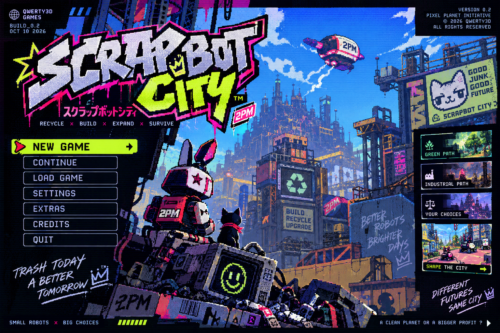

# Scrapbot City — build 0.6.0

City builder in pixel art: piccoli robot raccolgono spazzatura, tu decidi cosa diventa.
**Recycle × Build × Expand × Survive.** Un pianeta pulito o un profitto più grande?



## Avvio

```bash
cd scrapbot-city
npm install
npm run dev          # gioco nel browser: http://localhost:3001
npm run build        # dist/index.html: un unico file con codice, CSS e font
npm run balance      # partite automatiche su tutte le città per controllare il bilanciamento
npm run i18n:check   # controlla che le 7 traduzioni abbiano tutte le chiavi, i {segnaposto} e i tag dell'inglese
npm run art          # rigenera gli sprite isometrici dai modelli voxel (atlante + PNG singoli + foglio di controllo)
npm test             # test automatici (proiezione, ordine di disegno, salvataggi, simulazione)
npm run desktop      # app desktop (Electron)
npm run dist:win     # build per Steam in release/ (anche dist:linux, dist:mac)
```

Per pubblicare su Steam segui **[docs/STEAM.md](docs/STEAM.md)**: account, achievement, Steam Cloud, Steam Deck, upload,
pagina del negozio, prezzo. Per i test con giocatori veri c'è **[docs/PLAYTEST.md](docs/PLAYTEST.md)**.

## Modalità di gioco

- **Campagna "The Scrap Coast"**: 5 città sulla mappa della regione, ognuna con regole proprie e 3 stelle da guadagnare.
  Le stelle sbloccano le città successive. Una **banca regionale** (il dirigibile cargo) sposta crediti e pezzi tra le città,
  trattenendo il 10%.
  | Città | Regole | Si sblocca con |
  |---|---|---|
  | Scrapbot City | equilibrata | subito |
  | Rustbay | spazzatura ×1,6, tempeste di spazzatura ×2 | 1 ★ |
  | Neon Heights | melma tossica ×3, partenza ricca, più eventi | 3 ★ |
  | Greenvale | poca spazzatura, molta erba, industria cara | 5 ★ |
  | 2PM Company Town | industria economica, l'aria si pulisce lentamente | 8 ★ |

  Quando tutte e 5 le Guglie sono completate arriva il finale della regione.
- **Free play**: una città con nome e seed a scelta. Prima di sostituire la città salvata il gioco chiede conferma.
- **Tutorial**: USA-9 guida passo passo, evidenzia i pulsanti e aspetta che tu esegua ogni azione.

## Cosa c'è nel gioco

- **Suggerimenti** (lampadina o tasto `Q`): USA-9 legge la città e consiglia cosa costruire, spiegando il perché.
  I primi 3 per città sono gratis e uno nuovo torna ogni 5 giorni. Poi si pagano in crediti, e il prezzo sale a ogni acquisto.
- **18 achievement**, salvati localmente e inviati a Steam nella versione desktop.
- **Eventi narrativi** con USA-9, Miso, K. Kurogane (2PM Corp), i cittadini e la Pixel Planet Initiative.
- **Finali**: Garden City, 2PM Megacity, Different Futures, Smog Over. Dopo la Guglia si può continuare a costruire
  per prendere le stelle mancanti; se la città soffoca si riparte dall'ultimo salvataggio automatico.
- **Salvataggi** automatici a ogni nuovo giorno, alla chiusura e quando la finestra viene nascosta. In free play ci sono anche 3 slot manuali.
  Nella versione desktop sono file `.sav` nella cartella dell'utente, sincronizzabili con **Steam Cloud**.
- **8 lingue**: English, Italiano, Deutsch, Français, Español, Português, Polski, Nederlands. Al primo avvio il gioco
  usa la lingua del sistema; si cambia al volo dal globo nel menu o dalle impostazioni, anche a partita in corso.
- **Controller e Steam Deck**: menu e dialoghi col D-pad, in città un cursore virtuale (vedi Comandi).
- **Musica**: 4 brani chiptune sintetizzati dal codice — *Trash Today* (menu), *Rust & Sunshine* (città di giorno),
  *Neon Hum* (città di notte), *Road Trip* (mappa della regione) — con dissolvenza da uno all'altro.
- **Interfaccia**: chip colorate, guadagno al minuto di crediti e pezzi, pausa automatica quando la finestra è nascosta,
  pixel art nitida anche con lo schermo scalato al 125–150%.

## Loop di gioco

1. I **bot** volano sui cumuli e portano i rottami all'HQ o a un Bot Dock.
2. Il **Recycler** trasforma i rottami in pezzi; Smelter, Fix-It Lab e 2PM Factory producono crediti.
3. I **Bot Pods** portano cittadini: pagano le tasse e producono nuova spazzatura.
4. L'**energia** va tenuta sopra il consumo, altrimenti tutto rallenta.
5. Lo **smog** sale con l'industria e scende con giardini e purificatori. Sopra il 95% per 30 secondi la città è persa.
6. Con 30 cittadini si costruisce la **Scrap Spire**. Il finale dipende dall'indicatore Green ◀ ▶ Industry,
   che si muove con gli edifici in piedi e con le scelte degli eventi.

## Comandi

Le scorciatoie usano la posizione fisica dei tasti, quindi funzionano anche su tastiere AZERTY e simili;
i testi di aiuto mostrano i nomi dei tasti della tastiera del giocatore (per esempio ZQSD su AZERTY).

| Azione | Tasti |
|---|---|
| Muovere la camera | WASD, frecce, trascinare |
| Zoom | rotella, pinch su trackpad e touch, `+` / `-` |
| Scegliere un edificio | `1`–`0`, `M` per la Scrap Spire |
| Ruspa (macerie) | `X` |
| Suggerimento | `Q` |
| Annullare | clic destro, `Esc` |
| Pausa / velocità | `Space` / `Tab` |
| Tornare all'HQ | `H` |
| Schermo intero (desktop) | `F11` |

Con il **controller**: stick sinistro = cursore, stick destro = mappa, `A` costruisce o seleziona, `B` annulla,
`LB`/`RB` scelgono l'edificio, `LT`/`RT` zoom, `X` ruspa, `Y` suggerimento, `Start` menu,
D-pad = una casella alla volta, `View` pausa, `L3` velocità, `R3` torna all'HQ. Nei menu: D-pad o stick, `A` conferma, `B` indietro.

## Struttura

```
src/
  main.ts              schermate: menu, regione, partita, tutorial, free play
  session.ts           partita in corso: loop, input, camera, dialoghi, finali
  campaign.ts          stelle, sblocchi, banca regionale, finale della regione
  achievements.ts      achievement locali e ponte verso Steam
  storage.ts           impostazioni e slot di salvataggio (file su desktop, localStorage nel browser)
  audio.ts             effetti sonori e lettore dei brani
  music.ts             i 4 brani, scritti come note in battute da 16 step
  gamepad.ts           controller: navigazione dei menu e cursore virtuale
  keys.ts              nomi dei tasti secondo la tastiera del giocatore
  i18n/                dizionari: en.ts è la fonte, poi it, de, fr, es, pt, pl, nl
  game/                logica pura, senza DOM (testabile in Node)
    defs.ts            edifici, costi, energia, smog, modificatori delle città
    cities.ts          le 5 città della campagna e i loro obiettivi a stelle
    hints.ts           i consigli di USA-9
    sim.ts             simulazione a passo fisso
    state.ts           stato e salvataggi (versione 2, legge anche la 1)
    actions.ts, story.ts, world.ts
  render/              renderer isometrico, icone, menu e mappa della regione
    renderer.ts        il mondo in 2.5D: terreno in cache, ordine di disegno, ombre, luci, clic sugli sprite
    iso/               proiezione, atlante, ordinamento per profondità, cittadini e scenografia
  assets/iso/          atlante generato da npm run art (atlas.png + atlas.json con gli ancoraggi)
  ui/                  menu, HUD, tutorial, regione, finestre di dialogo
electron/              app desktop per Steam
scripts/balance.ts     pilota automatico per il bilanciamento
scripts/art/           pipeline della grafica: modelli voxel (models/), ray casting (voxel.ts), PNG, atlante
art/sprites/           ogni fotogramma come PNG singolo; art/contact-sheet.png li mostra tutti
art/overrides/         PNG ritoccati a mano con lo stesso nome di uno sprite: sostituiscono quello generato
docs/ISO-MIGRATION.md  piano tecnico del passaggio all'isometrico
scripts/i18n-check.ts  controllo delle traduzioni
docs/STEAM.md          guida alla pubblicazione su Steam
docs/PLAYTEST.md       come organizzare un playtest e cosa osservare
```

## Ancora da fare

- Musica di un compositore, passata grafica di un artista pixel, playtest con persone nuove, revisione madrelingua delle traduzioni.
- Dettagli in [docs/STEAM.md](docs/STEAM.md), sezione 9.
